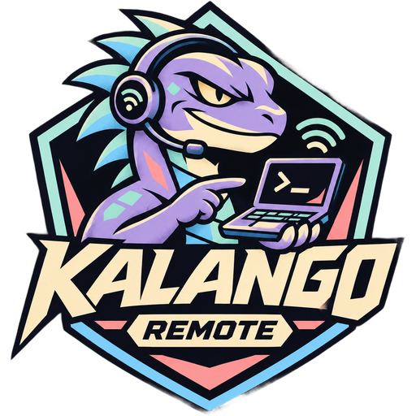

<p align="center">
  
</p>

<h1 align="center">Kalango Remote</h1>

<p align="center">
  O acesso remoto nativo do <a href="https://kalangoos.com">KalangoOS</a>: controlar outro computador, compartilhar a
  tela e acessar servidores por SSH e Mosh — sem domínio e sem servidor próprio.
</p>

---

## O que ele faz

- **Compartilhar a tela e controlar outro computador.** Quem compartilha recebe um código e um link para passar
  adiante; quem recebe o pedido aprova antes, vendo quem é e o que a pessoa vai poder fazer (ver a tela, controlar,
  arquivos, áudio). Enquanto alguém controla, o computador mostra sempre: um aviso na barra, um contorno na tela e o
  cursor com o nome de quem está controlando — e um botão para parar.
- **Conexão sem servidor.** O Kalango Remote abre na hora um túnel temporário do Cloudflare (`cloudflared`), sem
  conta, domínio nem servidor do KalangoOS no meio. Na mesma rede, conecta direto. Quem preferir pode usar um servidor
  próprio compatível com o RustDesk.
- **Arquivos e chat** durante a sessão, com uma fila de transferências.
- **SSH e Mosh.** Servidores e grupos (com configurações herdadas do grupo), importação do `~/.ssh/config` e do
  `known_hosts`, chaves no cofre do sistema, confirmação da impressão digital na primeira conexão e bloqueio quando a
  chave do servidor muda, encaminhamento de portas e saltos (ProxyJump). As sessões abrem como abas do Terminal do
  KalangoOS, com o painel de arquivos (SFTP) ao lado.
- **O agente do KalangoOS ajuda** — "conecte no computador da minha mãe e…" — e só age com aprovação, dos dois
  lados. Ele nunca lê o cofre de senhas e chaves nem aceita a chave de um servidor por conta própria.

## Estado

Em desenvolvimento, já usável entre dois computadores Linux. O que funciona e foi testado (detalhes e números em
[`docs/POC.md`](docs/POC.md)):

- **Compartilhar** pelo túnel rápido do Cloudflare (sem conta e sem servidor nosso) ou só na rede local; código,
  link, QR, senha de uso único, prazo, pedido de acesso com aprovação e o indicador "está controlando".
- **Conectar** por link (de qualquer lugar, sem precisar do `cloudflared` deste lado) ou por código (na mesma rede),
  sempre **cifrado de ponta a ponta**: o convite leva a identidade de quem compartilha e outra chave é recusada.
- **Sessão** com a tela remota, barra que se esconde, qualidade, escala, chat, transferência de arquivos e
  reconexão. No KalangoOS (niri), a captura é por `wlr-screencopy` e o controle por teclado e ponteiro virtuais —
  só para o núcleo do Kalango Remote, e só depois que a pessoa aprovou (o `kalangod` dá a permissão ao niri).
- **Parar** a qualquer momento: o botão no aviso ou **Esc Esc** em qualquer janela (no niri do KalangoOS).
- **SSH**: servidores em grupos com herança, importar `~/.ssh`, chaves no chaveiro do sistema, impressão digital
  conferida antes de conectar (chave trocada é bloqueada), encaminhamentos de porta. As sessões abrem no Terminal do
  KalangoOS (contrato em [`docs/HOSTS.md`](docs/HOSTS.md); teste com `kalangoos/scripts/testar-ssh.sh`).

- **Acesso sem supervisão** (senha fixa, que entra sem aprovação enquanto a de uso único continua pedindo),
  **verificação em duas etapas** (código do app autenticador, com QR code), **gravar as sessões** (recebidas e feitas,
  em Vídeos › Kalango Remote, apagadas depois de 30 dias) e **travar a tela** ao fim da sessão.
- **Servidor próprio** (RustDesk-compatível): o computador se registra nele, o cartão mostra o id e quem conecta digita o
  id. Testado com o hbbs/hbbr oficiais (`kalangoos/scripts/testar-sessao.sh servidor`).
- **O plano do agente**: `kalango-remote agent-plan ARQUIVO|-` mostra o plano para aprovação e responde com a decisão
  (contrato em `kalangoos/app/src/plan.rs`; teste em `kalangoos/scripts/testar-plano.sh`).

Ainda não: o modo privacidade (tela preta só aqui) — a captura por `wlr-screencopy` pegaria a cobertura e o outro lado
veria preto; precisa de apoio do compositor do KalangoOS. Não testado: o niri numa sessão de verdade (só aninhado) e dois
computadores físicos.

### Compilar e rodar (Ubuntu 24.04, sem sudo)

```sh
kalangoos/scripts/deps.sh            # bibliotecas de desenvolvimento e a fonte Inter em kalangoos/.deps
kalangoos/scripts/cloudflared.sh     # cloudflared 2026.10.7 com SHA-256 conferido (só quem compartilha precisa)
source kalangoos/scripts/env.sh
cargo build -p kalango-remote -p kalango-remote-core --features kalango-remote-core/linux-pkg-config
kalangoos/scripts/rodar-app.sh       # o app; --demo abre com um perfil descartável de dados inventados
```

O `gtk4-layer-shell` (contorno e aviso "está controlando" por cima da tela) vem do KalangoOS; fora dele, o
`env.sh` usa a cópia compilada em `SDRustOS/poc/.deps` quando o repositório do KalangoOS está ao lado.

Testes: `cargo test -p kalango-remote -p kalango-remote-proto -p kalango-remote-core -p wlr_remote
--features kalango-remote-core/linux-pkg-config`; sessões de verdade com `kalangoos/scripts/testar-sessao.sh`
(direto, túnel, código, impostor, aprovação, niri) e o fluxo pela interface com `kalangoos/scripts/testar-app.sh`.

## Como o repositório se organiza

- `kalangoos/` — o que é do Kalango Remote: o app nativo, a integração com o KalangoOS, o logo e o ícone.
- O resto é o núcleo do RustDesk (rede, codecs, captura, protocolo), que o Kalango Remote usa por baixo.
- O ramo `kalangoos` é o do Kalango Remote; o `master` acompanha o RustDesk.

## Contribuir

Issues e pull requests são bem-vindos no ramo `kalangoos`. As regras da casa do KalangoOS valem aqui também:
[AGENTS.md do KalangoOS](https://github.com/kalangoos/kalangoos/blob/main/AGENTS.md).

## Licença e créditos

AGPL-3.0 (veja [LICENCE](LICENCE)). O Kalango Remote é baseado no
[RustDesk](https://github.com/rustdesk/rustdesk), da Purslane Tech Pte. Ltd. e colaboradores, também sob a AGPL-3.0: quem
distribui ou oferece o Kalango Remote como serviço precisa disponibilizar o código-fonte das suas mudanças.
